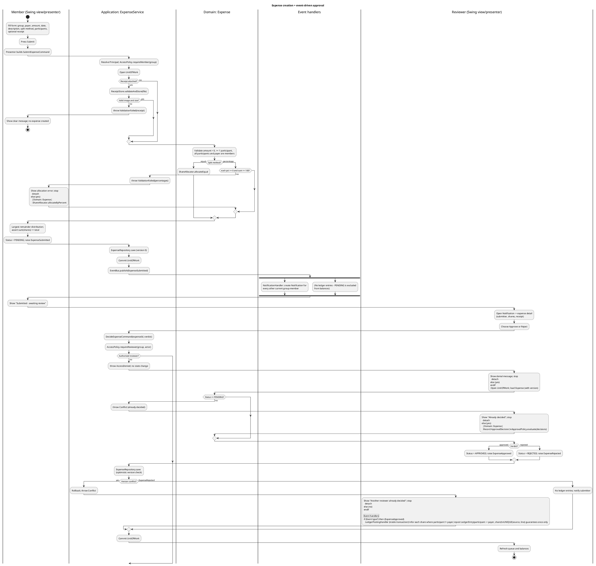

# SplitSmart — Alternative Architecture: Hexagonal Core with an Event-Driven Approval Workflow

**Status**: Proposal (AI-generated; requires human review per Constitution Principle V)
**Inputs read**: `UserRequirement.md`, `specs/001-expense-sharing/spec.md`, `.specify/memory/constitution.md`
**Inputs deliberately not read**: Spec Kit plan, research, data-model, and contracts artifacts
**Scope**: Java 21 / Maven / Swing MVP, designed so the web/Android/iOS clients (FR-016) can be added later without touching business logic.

---

## 1. Summary of the Alternative

A conventional layered design (View → Controller → Service → DAO) tends to let the persistence model leak upward and lets the "approval" rule live inside a service method that mutates balances directly. This proposal differs in three ways:

1. **Hexagonal (ports-and-adapters) core.** The domain and application layers depend on *nothing* except the JDK. Swing, storage, file access, password hashing, clock, and email verification are all **adapters** plugged into **ports** (Java interfaces owned by the core). Dependencies point inward only. Swing is just one *driving* adapter.
2. **Event-driven approval workflow.** An expense is an aggregate with an explicit state machine (`PENDING → APPROVED | REJECTED`). Transitions emit **domain events** (`ExpenseSubmitted`, `ExpenseApproved`, `ExpenseRejected`, `PaymentRecorded`, `PaymentConfirmed`). Notifications, ledger posting, and report projections are **independent reactions** to those events rather than code called inline by the approval method.
3. **Ledger-derived balances.** Balances are never stored or edited. They are a **projection of an append-only ledger** whose entries are posted exactly once, keyed by the source expense or payment. This turns FR-011 ("affects balances no more than once") and SC-006 into a structural property (a uniqueness constraint) rather than a coding convention.

The Swing GUI uses a **Presenter / passive-view** pattern on top of the inbound ports, so no Swing class ever contains a business decision (Constitution II).

---

## 2. Component Breakdown

### 2.1 Package layout (single Maven module for the MVP; split into modules later if needed)

```
com.splitsmart
├── domain                      // pure Java, no framework imports, no javax.swing
│   ├── money                   // Money, CurrencyPolicy, ShareAllocator
│   ├── account                 // Account, EmailAddress, AccountId
│   ├── group                   // Group, Membership, GroupRole, ApprovalPolicy
│   ├── expense                 // Expense, ExpenseShare, ExpenseStatus, SplitSpec, Receipt
│   ├── payment                 // Payment, PaymentStatus
│   ├── ledger                  // LedgerEntry, Ledger (query-only view), PairBalance
│   └── event                   // DomainEvent + concrete events
├── application                 // use cases and ports; depends only on domain
│   ├── port.in                 // driving ports (use-case interfaces)
│   ├── port.out                // driven ports (repositories, stores, services)
│   ├── service                 // use-case implementations
│   ├── authz                   // AccessPolicy (membership / role checks)
│   ├── event                   // EventBus, handlers (projections / reactors)
│   └── query                   // read models: BalanceView, ReportView, NotificationView
├── adapter.in.swing            // views, presenters, view models, Swing wiring
├── adapter.out.persistence     // JDBC (SQLite) repositories + in-memory test doubles
├── adapter.out.files           // receipt file store
├── adapter.out.security        // PBKDF2 password hasher, token generator
├── adapter.out.system          // SystemClock, in-app "email" verification outbox
└── bootstrap                   // composition root (manual DI; the only place that knows all classes)
```

### 2.2 Responsibilities

| Component | Responsibility | May depend on |
|---|---|---|
| **Domain model** | Invariants and business rules: share allocation, expense state machine, payment state machine, approval policy, ledger entry creation. | JDK only |
| **Application services** (use cases) | Orchestrate a single use case: authorize → load aggregate → call domain → save → publish events, all inside a `UnitOfWork`. | domain, ports |
| **Inbound ports** | The only API the GUI (or a future REST controller) can call, e.g. `SubmitExpenseUseCase`, `DecideExpenseUseCase`. They accept and return plain DTOs/commands, never domain entities. | domain value types |
| **Outbound ports** | Interfaces the core needs: `AccountRepository`, `GroupRepository`, `ExpenseRepository`, `PaymentRepository`, `LedgerRepository`, `NotificationRepository`, `ReceiptStore`, `PasswordHasher`, `Clock`, `VerificationSender`, `UnitOfWork`. | domain |
| **Event bus + handlers** | In-process, synchronous publish/subscribe. Handlers: `LedgerPostingHandler`, `NotificationHandler`. Reports and balances are query-time projections of the ledger. | application |
| **Swing adapter** | Panels/frames render *view models*; presenters translate user gestures into commands and map results/errors into view-model updates. | inbound ports only |
| **Persistence adapter** | Implements repositories with JDBC; maps rows ↔ domain objects (mapping code lives here, not on the domain classes). | outbound ports |
| **Bootstrap** | Builds the object graph, selects adapters (real vs. in-memory), launches Swing on the EDT. | everything |

### 2.3 How the GUI stays separate from business logic

- **Compile-time boundary.** `adapter.in.swing` imports only `application.port.in` (and its DTOs). It has no import of `domain` entities, `port.out`, or JDBC. An ArchUnit-style test (or a simple Maven-enforcer/grep check in CI) fails the build if any class outside `adapter.in.swing` imports `javax.swing`/`java.awt`, or if `domain`/`application` import `adapter.*`.
- **Passive views.** Each screen is split into `XxxView` (an interface implemented by a Swing panel, containing only get/set/show methods) and `XxxPresenter` (plain Java, holds screen logic such as "disable Submit until a participant is chosen"). Presenters are tested with a fake `View`; **no Swing component is constructed in any business or presenter test**.
- **No domain objects in the UI.** Use cases return immutable DTOs (`ExpenseSummary`, `PairBalanceRow`, `ReportResult`). Money is shown through a `MoneyFormatter` in the adapter; the UI never does arithmetic.
- **Threading.** Use cases are synchronous and UI-agnostic. The Swing adapter runs them off the EDT with `SwingWorker` and marshals results back with `SwingUtilities.invokeLater`. Core code never knows about the EDT.
- **Errors.** Use cases throw typed application exceptions (`AccessDenied`, `ValidationFailed(List<FieldError>)`, `Conflict`). Presenters map them to messages (NFR-006); the core never produces UI text beyond stable error codes/messages.

### 2.4 Event-driven approval workflow

| Event | Raised by | Reacted to by | Effect |
|---|---|---|---|
| `ExpenseSubmitted` | `Expense.submit` | `NotificationHandler` | Creates one `Notification` per *other* current group member (FR-009). |
| `ExpenseApproved` | `Expense.approve` | `LedgerPostingHandler` | Posts ledger entries once (FR-011/FR-012). |
| `ExpenseRejected` | `Expense.reject` | `NotificationHandler` (optional) | Informs submitter; ledger untouched. |
| `PaymentRecorded` | `Payment.record` | `NotificationHandler` | Notifies recipient that confirmation is awaited. |
| `PaymentConfirmed` | `Payment.confirm` | `LedgerPostingHandler` | Posts a settling ledger entry once (FR-013). |

Design rules that make this safe:

- **Events are facts raised by aggregates, collected on the aggregate, and published by the application service after `save`** (outbox-style within the same `UnitOfWork`). Handlers needing atomicity with the state change (`LedgerPostingHandler`) run **inside** the transaction; purely informational handlers (`NotificationHandler`) run after commit, so a notification failure can never roll back an approval.
- **Exactly-once posting** is enforced three ways: (1) the aggregate state machine rejects a second decision (`PENDING` only), (2) the `expense` row has an optimistic `version` so two concurrent reviewers collide and the loser gets `Conflict`, and (3) `ledger_entry` has a `UNIQUE(source_type, source_id, line_no)` constraint so even a replayed event cannot double-post.
- **Approval policy is a strategy.** `ApprovalPolicy` is an interface with `SingleReviewerPolicy` implemented for the MVP. A `MultiStagePolicy` (all-of / threshold / sequential — Open Question 3) can be added later by implementing the same interface; `Expense` records `ApprovalDecision`s and asks the policy "is this now approved/rejected/still pending?".

---

## 3. Domain Model and Persistence

### 3.1 Money and rounding (Constitution III, NFR-001)

- `Money` is an immutable value object wrapping a `BigDecimal` plus a currency code. It is the **only** type that carries monetary amounts anywhere in `domain`, `application`, or DTOs. `double`/`float` are banned (enforced by a test scanning for them in these packages).
- `CurrencyPolicy` defines the scale (e.g. 2 for USD) per group. All construction goes through `Money.of(String|BigDecimal, CurrencyPolicy)`, which normalizes scale with an **explicit `RoundingMode`** (`HALF_EVEN`, applied only at input boundaries — never inside allocation).
- `ShareAllocator` (domain service) implements the clarified **largest-remainder rule**:
  1. Compute each exact share as `total × weight` (equal: `1/n`; percentage: `pct/100`) at high internal precision using `BigDecimal` division with `MathContext.DECIMAL128`.
  2. Floor each share to the currency scale.
  3. Distribute remaining minor units one at a time to participants ordered by descending fractional remainder; ties broken by a stable participant order (the order of `ExpenseShare.position`, assigned at submission).
  4. Assert `sum(shares) == total` before returning; otherwise throw an invariant error.
- Percentages are `BigDecimal` values validated `≥ 0` with sum exactly `100`.
- Persistence stores money as **integer minor units (`BIGINT`) plus currency**, never as a SQL float. This is exact, sortable, and sums correctly in SQL for reports.

### 3.2 Aggregates

| Aggregate | Root | Contains | Key invariants |
|---|---|---|---|
| **Account** | `Account` | `EmailAddress`, password hash, `verified` flag | Unique verified email (FR-001); unverified accounts cannot sign in (FR-002). |
| **Group** | `Group` | `Membership`s (role: `OWNER`, `MANAGER`, `MEMBER`), `canReview` flag, `CurrencyPolicy`, `ApprovalPolicy` | Only owner/manager changes membership (FR-003); at least one reviewer exists; removed members lose access. |
| **Expense** | `Expense` | payer, `ExpenseShare`s, `SplitSpec`, optional `Receipt` reference, `ApprovalDecision`s, `ExpenseStatus` | Amount > 0; ≥1 participant, all current members; payer may be in or out of participants (FR-005); shares sum to amount; only `PENDING` can be decided. |
| **Payment** | `Payment` | payer, recipient, amount, date, `PaymentStatus` | Amount > 0; only the recipient confirms; `PENDING → CONFIRMED` once. |
| **LedgerEntry** (append-only) | `LedgerEntry` | debtor, creditor, amount, source reference, effective date | Immutable; unique per (source, line). |

`Ledger` is not an aggregate that is saved; it is a **query abstraction** over `LedgerRepository` that computes `PairBalance`s.

### 3.3 Ledger semantics (FR-005, FR-012, FR-013)

- **On `ExpenseApproved`:** for each share with participant `p ≠ payer`, post `LedgerEntry(debtor=p, creditor=payer, +share)`. If the payer is a participant, their own share simply produces no entry — which is exactly the "net of the payer's own share" rule. If the payer is excluded, every participant owes the payer the full share. The two cases need no special branching beyond `p ≠ payer`.
- **On `PaymentConfirmed`:** post `LedgerEntry(debtor=payer, creditor=recipient, −amount)` (a settlement entry that reduces what the payer owes the recipient).
- **Pair balance:** `balance(A→B) = Σ entries(A→B) − Σ entries(B→A)`; presented as a signed net per unordered pair. Pending payments and PENDING/REJECTED expenses have no entries and are therefore reflected zero times (SC-006).
- **Payment validation:** at `record` time, amount must be `> 0` and `≤ outstanding(payer→recipient)`. Because several pending payments could together exceed the outstanding amount, the check is **repeated at confirm time** against the then-current balance; failure leaves the payment `PENDING` with a `ValidationFailed`.

### 3.4 Persistence approach

- **Store:** embedded **SQLite via JDBC** (single file, zero setup, transactional, supports unique constraints). Schema versioned with plain numbered SQL scripts run at startup (no ORM, to keep mapping explicit and the domain annotation-free). An implementation plan may substitute H2 or flat JSON; the port boundary makes that a local change.
- **Mapping:** each repository adapter maps rows to domain objects through reconstitution factories (`Expense.restore(...)`) that bypass command validation but re-check invariants. Domain classes carry no persistence annotations.
- **Transactions:** `UnitOfWork.execute(Supplier<T>)` wraps one JDBC transaction per use case; the event bus's in-transaction handlers join it.
- **Concurrency:** optimistic `version` column on `expense`, `payment`, and `group_membership`.
- **Receipts (FR-008):** `ReceiptStore` port; the file adapter validates type (e.g. PNG/JPEG by magic bytes, not just extension) and size, copies the file into an app-managed directory under a generated name, and the expense stores only the opaque `ReceiptRef`. Validation failure is reported, never silently ignored (edge case in spec). Allowed types/size are configuration pending Open Question 7.
- **Notifications:** persisted rows (`recipient`, `expense_id`, `created_at`, `read_at`); the Swing adapter polls on a timer or refreshes on demand (NFR-004 is trivially met in a single-process MVP).
- **Test doubles:** `InMemory*Repository` classes implement the same ports so almost every business test runs with no database and no Swing (Constitution II/IV).
- **Security:** `PasswordHasher` port with a PBKDF2WithHmacSHA256 adapter (JDK-only, salted, high iteration count). Email verification and password recovery issue single-use, expiring tokens through the `VerificationSender` port; the MVP adapter writes to an in-app "outbox" screen since there is no mail server.

---

## 4. PlantUML Class Diagrams

### 4.1 Domain model

```plantuml
@startuml
title SplitSmart - Domain Model (pure Java, BigDecimal money)
skinparam classAttributeIconSize 0
hide empty members

class Money <<value object>> {
  -amount : BigDecimal
  -currency : String
  +of(amount, policy) : Money
  +plus(Money) : Money
  +minus(Money) : Money
  +isPositive() : boolean
}

class CurrencyPolicy <<value object>> {
  -code : String
  -scale : int
  -roundingMode : RoundingMode
}

class ShareAllocator <<domain service>> {
  +allocateEqual(total, participants) : List<Money>
  +allocateByPercent(total, percents) : List<Money>
}

class Account <<aggregate root>> {
  -id : AccountId
  -email : EmailAddress
  -passwordHash : String
  -verified : boolean
  +verifyEmail(token)
  +changePassword(hash)
}

class Group <<aggregate root>> {
  -id : GroupId
  -name : String
  +addMember(actor, accountId)
  +removeMember(actor, accountId)
  +designateManager(actor, accountId)
  +isMember(accountId) : boolean
  +canReview(accountId) : boolean
}

class Membership {
  -accountId : AccountId
  -role : GroupRole
  -reviewer : boolean
}

enum GroupRole {
  OWNER
  MANAGER
  MEMBER
}

interface ApprovalPolicy <<strategy>> {
  +evaluate(decisions, group) : ExpenseStatus
  +isEligibleReviewer(group, accountId) : boolean
}

class SingleReviewerPolicy
class MultiStagePolicy <<future>>

class Expense <<aggregate root>> {
  -id : ExpenseId
  -groupId : GroupId
  -submitter : AccountId
  -payer : AccountId
  -total : Money
  -date : LocalDate
  -description : String
  -status : ExpenseStatus
  -version : long
  +submit(...) : Expense {static}
  +approve(reviewer, policy)
  +reject(reviewer, policy, reason)
  +pullEvents() : List<DomainEvent>
}

class ExpenseShare {
  -participant : AccountId
  -position : int
  -percent : BigDecimal
  -amount : Money
}

class SplitSpec <<value object>> {
  -method : SplitMethod
  -percents : Map<AccountId, BigDecimal>
}

enum SplitMethod {
  EQUAL
  PERCENTAGE
}

enum ExpenseStatus {
  PENDING
  APPROVED
  REJECTED
}

class ApprovalDecision {
  -reviewer : AccountId
  -verdict : Verdict
  -stage : int
  -decidedAt : Instant
}

class ReceiptRef <<value object>> {
  -opaqueId : String
  -contentType : String
}

class Payment <<aggregate root>> {
  -id : PaymentId
  -groupId : GroupId
  -payer : AccountId
  -recipient : AccountId
  -amount : Money
  -date : LocalDate
  -status : PaymentStatus
  -version : long
  +record(...) : Payment {static}
  +confirm(actor)
  +pullEvents() : List<DomainEvent>
}

enum PaymentStatus {
  PENDING
  CONFIRMED
}

class LedgerEntry <<immutable, append-only>> {
  -id : long
  -groupId : GroupId
  -debtor : AccountId
  -creditor : AccountId
  -amount : Money
  -sourceType : SourceType
  -sourceId : String
  -lineNo : int
  -effectiveDate : LocalDate
}

class Ledger <<query abstraction>> {
  +balanceBetween(a, b) : PairBalance
  +balancesFor(group) : List<PairBalance>
  +outstanding(debtor, creditor) : Money
}

class PairBalance <<value object>> {
  -from : AccountId
  -to : AccountId
  -net : Money
}

interface DomainEvent
class ExpenseSubmitted
class ExpenseApproved
class ExpenseRejected
class PaymentRecorded
class PaymentConfirmed

Money --> CurrencyPolicy
ShareAllocator ..> Money
Group "1" *-- "1..*" Membership
Membership --> GroupRole
Group --> ApprovalPolicy
SingleReviewerPolicy ..|> ApprovalPolicy
MultiStagePolicy ..|> ApprovalPolicy
Expense "1" *-- "1..*" ExpenseShare
Expense *-- SplitSpec
Expense "1" *-- "0..*" ApprovalDecision
Expense o-- "0..1" ReceiptRef
Expense --> ExpenseStatus
Expense ..> ShareAllocator : uses
Expense ..> DomainEvent : raises
SplitSpec --> SplitMethod
ExpenseShare --> Money
Payment --> PaymentStatus
Payment --> Money
Payment ..> DomainEvent : raises
Ledger o-- "*" LedgerEntry
Ledger ..> PairBalance
ExpenseSubmitted ..|> DomainEvent
ExpenseApproved ..|> DomainEvent
ExpenseRejected ..|> DomainEvent
PaymentRecorded ..|> DomainEvent
PaymentConfirmed ..|> DomainEvent
@enduml
```



### 4.2 Hexagon: ports, services, and adapters

```plantuml
@startuml
title SplitSmart - Hexagonal Structure (dependencies point inward)
skinparam classAttributeIconSize 0
hide empty members

package "adapter.in.swing (driving)" {
  class SwingMain
  interface ExpenseFormView
  class ExpenseFormPanel <<javax.swing>>
  class ExpenseFormPresenter
  interface ReviewQueueView
  class ReviewQueuePanel <<javax.swing>>
  class ReviewQueuePresenter
  class BalanceScreenPresenter
  class ReportScreenPresenter
  class NotificationPresenter
  class MoneyFormatter
}

package "application.port.in (driving ports)" {
  interface RegisterAccountUseCase
  interface SignInUseCase
  interface ManageGroupUseCase
  interface SubmitExpenseUseCase
  interface DecideExpenseUseCase
  interface RecordPaymentUseCase
  interface ConfirmPaymentUseCase
  interface QueryBalancesUseCase
  interface QueryNotificationsUseCase
  interface GenerateReportUseCase
}

package "application.service" {
  class AccountService
  class GroupService
  class ExpenseService
  class PaymentService
  class BalanceQueryService
  class ReportService
  class NotificationQueryService
}

package "application.core" {
  class AccessPolicy
  class EventBus
  interface EventHandler<E>
  class LedgerPostingHandler
  class NotificationHandler
}

package "application.port.out (driven ports)" {
  interface AccountRepository
  interface GroupRepository
  interface ExpenseRepository
  interface PaymentRepository
  interface LedgerRepository
  interface NotificationRepository
  interface ReceiptStore
  interface PasswordHasher
  interface VerificationSender
  interface Clock
  interface UnitOfWork
}

package "adapter.out (driven)" {
  class JdbcExpenseRepository
  class JdbcGroupRepository
  class JdbcLedgerRepository
  class JdbcUnitOfWork
  class FileReceiptStore
  class Pbkdf2PasswordHasher
  class InAppVerificationOutbox
  class SystemClock
  class InMemoryRepositories <<test double>>
}

package "domain" {
  class Expense
  class Payment
  class Group
  class Ledger
  class ShareAllocator
}

ExpenseFormPanel ..|> ExpenseFormView
ExpenseFormPresenter --> ExpenseFormView
ReviewQueuePanel ..|> ReviewQueueView
ReviewQueuePresenter --> ReviewQueueView
ExpenseFormPresenter --> SubmitExpenseUseCase
ReviewQueuePresenter --> DecideExpenseUseCase
BalanceScreenPresenter --> QueryBalancesUseCase
ReportScreenPresenter --> GenerateReportUseCase
NotificationPresenter --> QueryNotificationsUseCase

ExpenseService ..|> SubmitExpenseUseCase
ExpenseService ..|> DecideExpenseUseCase
PaymentService ..|> RecordPaymentUseCase
PaymentService ..|> ConfirmPaymentUseCase
AccountService ..|> RegisterAccountUseCase
AccountService ..|> SignInUseCase
GroupService ..|> ManageGroupUseCase
BalanceQueryService ..|> QueryBalancesUseCase
ReportService ..|> GenerateReportUseCase
NotificationQueryService ..|> QueryNotificationsUseCase

ExpenseService --> AccessPolicy
ExpenseService --> ExpenseRepository
ExpenseService --> ReceiptStore
ExpenseService --> UnitOfWork
ExpenseService --> EventBus
PaymentService --> PaymentRepository
PaymentService --> LedgerRepository
PaymentService --> EventBus
AccountService --> AccountRepository
AccountService --> PasswordHasher
AccountService --> VerificationSender
BalanceQueryService --> LedgerRepository
ReportService --> LedgerRepository
ReportService --> ExpenseRepository
ReportService --> PaymentRepository

EventBus o-- EventHandler
LedgerPostingHandler ..|> EventHandler
NotificationHandler ..|> EventHandler
LedgerPostingHandler --> LedgerRepository
NotificationHandler --> NotificationRepository
NotificationHandler --> GroupRepository

JdbcExpenseRepository ..|> ExpenseRepository
JdbcGroupRepository ..|> GroupRepository
JdbcLedgerRepository ..|> LedgerRepository
JdbcUnitOfWork ..|> UnitOfWork
FileReceiptStore ..|> ReceiptStore
Pbkdf2PasswordHasher ..|> PasswordHasher
InAppVerificationOutbox ..|> VerificationSender
SystemClock ..|> Clock
InMemoryRepositories ..|> ExpenseRepository

ExpenseService ..> Expense
PaymentService ..> Payment
GroupService ..> Group
BalanceQueryService ..> Ledger
Expense ..> ShareAllocator
@enduml
```



> Note: `javax.swing` appears only in the `<<javax.swing>>` panels; presenters and everything inward are Swing-free.

---

## 5. PlantUML Activity Diagrams

### 5.1 Expense creation, notification, and approval



### 5.2 Payment settlement (pending until recipient confirms)

```plantuml
@startuml
title Payment settlement - record, confirm, post to ledger
|Payer (Swing)|
start
:Open Balances; choose member they owe;
:Enter amount and date; Submit;

|Application: PaymentService|
:AccessPolicy.requireMember(group) for payer and recipient;
:Open UnitOfWork;
:outstanding = Ledger.outstanding(payer -> recipient);

|Domain: Payment|
if (amount > 0 and amount <= outstanding?) then (no)
  |Application: PaymentService|
  :throw ValidationFailed(amount);
  |Payer (Swing)|
  :Show clear message; balances unchanged;
  stop
  detach
else (yes)
  |Domain: Payment|
  :Create Payment(status = PENDING);\nraise PaymentRecorded;
endif

|Application: PaymentService|
:PaymentRepository.save; commit;
:EventBus.publish(PaymentRecorded);

|Event handlers|
:NotificationHandler: notify recipient\n"confirmation awaited";
note right: No ledger entry yet.\nBalances unchanged while PENDING.

|Payer (Swing)|
:Payment shown in history as PENDING;

|Recipient (Swing)|
:Open pending payments; choose Confirm;

|Application: PaymentService|
:ConfirmPaymentCommand(paymentId);
:Open UnitOfWork; load Payment (with version);

|Domain: Payment|
if (Actor is the recipient?) then (no)
  |Application: PaymentService|
  :throw AccessDenied; no change;
  |Recipient (Swing)|
  :Show denial; stop
  detach
else (yes)
endif
|Domain: Payment|
if (Status == PENDING?) then (no)
  |Application: PaymentService|
  :throw Conflict (already confirmed);
  |Recipient (Swing)|
  :Show message; stop
  detach
else (yes)
endif
|Application: PaymentService|
:Re-check amount <= current outstanding\n(other payments may have confirmed first);
if (Still valid?) then (no)
  :throw ValidationFailed; payment stays PENDING;
  |Recipient (Swing)|
  :Show clear message; stop
  detach
else (yes)
endif

|Domain: Payment|
:Status = CONFIRMED; raise PaymentConfirmed;

|Application: PaymentService|
:PaymentRepository.save (version check);

|Event handlers|
:LedgerPostingHandler (inside transaction):\npost LedgerEntry(payer -> recipient, -amount)\nUNIQUE(source, line) guarantees once-only;

|Application: PaymentService|
:Commit UnitOfWork;

|Recipient (Swing)|
:Balance views now show reduced outstanding amount;
stop
@enduml
```

---

## 6. Traceability: Components → Requirements

Legend: ● primary owner, ○ supporting. "MVP" = included in the Swing slice per the spec's *Java Swing MVP Subset*.

| Component | FR-IDs | NFR/AC | MVP? | Notes |
|---|---|---|---|---|
| `Account`, `EmailAddress`, `AccountService`, `PasswordHasher`, `VerificationSender` | ● FR-001, ● FR-002 | AC-001, NFR-002 | Yes | Unique verified email; recovery via expiring single-use token. |
| `AccessPolicy` (application.authz) | ● FR-002 (scope), ○ FR-003, ○ FR-008–FR-015 | NFR-002, AC-002, SC-003 | Yes | Single choke point called by every use case; unit-testable with in-memory repos. |
| `Group`, `Membership`, `GroupRole`, `GroupService` | ● FR-003 | AC-002 | Yes | Owner/manager mutate membership; ordinary members denied. |
| `Expense`, `SplitSpec`, `ExpenseService.submit` | ● FR-004, ● FR-005 | AC-003 | Yes | Payer in/out of participants. |
| `ShareAllocator`, `Money`, `CurrencyPolicy` | ● FR-006, ● FR-007 | NFR-001, AC-004, AC-005, SC-002 | Yes | BigDecimal; largest-remainder; stable order. |
| `Receipt`/`ReceiptRef`, `ReceiptStore`, `FileReceiptStore` | ● FR-008 | AC-006 | Yes | Magic-byte validation; opaque ref. |
| `DomainEvent`s, `EventBus`, `NotificationHandler`, `Notification`, `NotificationQueryService` | ● FR-009 | NFR-004, AC-007, SC-005 | Yes (in-app only) | Per other-member notifications; non-members never receive. |
| `ApprovalPolicy`, `SingleReviewerPolicy`, `ApprovalDecision`, `DecideExpenseUseCase` | ● FR-010 | AC-008 | Single-reviewer only | `MultiStagePolicy` is the extension point for the full product. |
| `ExpenseStatus` state machine, `LedgerPostingHandler`, unique ledger constraint | ● FR-011 | AC-008, SC-006 | Yes | Exactly-once by state machine + version + unique key. |
| `LedgerEntry`, `Ledger`, `PairBalance`, `BalanceQueryService` | ● FR-012 | AC-009, SC-006 | Yes | Balances derived, never stored. |
| `Payment`, `PaymentService`, `ConfirmPaymentUseCase` | ● FR-013 | AC-010 | Yes | Pending until recipient confirms; excess rejected twice. |
| `ReportService`, `ReportView` (read models over ledger/expense/payment repos) | ● FR-014, ● FR-015 | AC-011 | Yes | Inclusive date range; `end < start` → `ValidationFailed`; empty → zero totals. |
| Swing presenters/views (`adapter.in.swing`) | ○ FR-001–FR-015 (UI for each) | NFR-006, SC-001 | Yes | Messages for rejected input; no business logic. |
| `UnitOfWork`, JDBC repositories, optimistic `version` | ○ FR-011 | NFR-003, NFR-006 | Yes | Atomic approve + post; indexed queries for 10k expenses. |
| *(Future)* REST inbound adapter, web SPA, Android/iOS clients | ● FR-016 | NFR-005, AC-012, SC-007 | **No** | See §8. |

Test traceability convention (Constitution I/IV): JUnit 5 classes named per component, with `@Tag("FR-006")`/`@DisplayName("AC-004 ...")` so a report can be generated from tags.

---

## 7. Trade-offs

### 7.1 Strengths

- **Strongest possible GUI/logic separation.** The Swing adapter physically cannot reach domain or persistence classes; Constitution II becomes a compile-time and CI-enforced property rather than a review-time hope.
- **Business rules tested fast and Swing-free.** In-memory adapters mean allocation, authorization, approval, payment, and report rules run as plain JUnit 5 tests with no database or display.
- **Exactly-once balance effects by construction** (state machine + optimistic lock + unique ledger key) directly serves FR-011/SC-006, the highest-risk financial rule.
- **Auditable balances.** The append-only ledger can always be re-summed to prove a balance, and reports are projections of the same source of truth, so reports and balances cannot disagree.
- **Workflow is extensible without edits to existing code.** New reactions (email, push, audit log) are new `EventHandler`s; multi-stage approval is a new `ApprovalPolicy`.
- **Platform-ready.** The same use cases can be exposed over HTTP for the web/mobile requirement (FR-016) by adding an adapter, not rewriting the core.
- **Money correctness is localized** in `Money`/`ShareAllocator`, so the BigDecimal/rounding rule has one home.

### 7.2 Weaknesses

- **More types and indirection than the MVP strictly needs** (ports, DTOs, presenters, events). For a small class project, the boilerplate-to-feature ratio is higher than layered MVC, and onboarding takes longer.
- **DTO/domain mapping duplication** at the use-case boundary and again in persistence mapping.
- **Event flow is harder to trace** when debugging than a direct method call; stack traces cross the bus.
- **Mixed sync/async semantics** (in-transaction vs. after-commit handlers) must be understood and tested; mislabeling a handler is a subtle bug source.
- **Derived balances cost read time.** Summing ledger entries is O(entries per group); fine at 10,000 expenses with indexes but needs measurement against NFR-003.
- **Manual dependency injection** in `bootstrap` grows as ports multiply (no framework by choice).

### 7.3 Risks and mitigations

| Risk | Impact | Mitigation |
|---|---|---|
| Over-engineering delays the MVP | Schedule | Build vertical slices (account → group → expense → approve → balance); start with in-memory adapters; add JDBC after core tests pass. |
| Layer rules erode (Swing imports a domain class) | Violates Constitution II | Automated import-rule test in the Maven build; fail CI. |
| Ledger double-post via replayed event | Wrong balances | `UNIQUE(source_type, source_id, line_no)` plus idempotent handler test. |
| Post-commit handler fails after approval | Missing notification | Notifications are non-critical; use an outbox row with retry on next startup, and test the failure path. |
| Rounding drift | Money errors | Allocation asserts `sum == total`; property-style tests for 1–100 participants (AC-004), tie-break order tests. |
| Concurrent decisions/payments | Double effect | Optimistic versioning and confirm-time re-validation (both specified above). |
| Open questions change the model (currency precision, multi-stage rules, receipt limits) | Rework | `CurrencyPolicy`, `ApprovalPolicy`, and receipt rules are already abstractions with the MVP values as defaults. |
| SQLite JDBC adds a third-party dependency | Build/licensing | Isolated to one adapter; in-memory/H2/JSON alternative swappable behind the same ports. |
| AI-generated design contains errors | Incorrect build | Human review of this document and diagrams before acceptance (Constitution V). |

---

## 8. Outside the Swing MVP, and How This Design Extends

The Swing MVP is a desktop slice. Per the spec, it **does not satisfy FR-016** (primary web experience plus Android and iOS applications), and these items are also outside the MVP:

| Out of MVP scope | Source | How the design extends |
|---|---|---|
| Web client (primary product) | FR-016, AC-012 | Add `adapter.in.rest` (e.g. a Java HTTP server, or a separate Spring/Javalin module) that maps HTTP+JSON to the **same inbound ports**; add token-based session handling via a new `SessionPort`. Domain and application code is reused unchanged. Promote the project to a multi-module Maven build (`domain`, `application`, `adapter-persistence`, `adapter-swing`, `adapter-rest`). |
| Android / iOS apps | FR-016, NFR-005 | Mobile apps are further clients of the REST adapter. Because all balance math happens in the core server-side, results are identical across clients (NFR-005, SC-007). Swing is not reused on mobile. |
| Multi-stage approval (all-of, threshold, sequential) | FR-010, Open Q3 | Implement `MultiStagePolicy`; `Expense` already stores `ApprovalDecision(stage)`; the `ExpenseApproved` event and ledger posting are unchanged. |
| Notification channels: email, push, SMS | FR-009, Open Q4 | Add new `EventHandler`s behind a `NotificationChannel` port; the event stream and `Notification` record stay. Add per-user preferences as a new aggregate. |
| Real email verification/recovery delivery | FR-001/FR-002 | Replace `InAppVerificationOutbox` with an SMTP adapter implementing `VerificationSender`. |
| Network-scale persistence and concurrency | NFR-003 | Replace SQLite with a server database in the persistence adapter; ledger projections can become materialized balance tables updated by the same handlers if measurement requires. |
| Multi-currency | Open Q1 | `Money` already carries a currency and groups carry a `CurrencyPolicy`; adding cross-currency rules is a domain extension. |
| Report export/sharing | Open Q5 | New `ReportExporter` outbound port (CSV/PDF adapters) fed by the existing `ReportView`. |
| Receipt storage at scale | Open Q7 | Swap `FileReceiptStore` for an object-store adapter. |

---

## 9. Open Items for Human Review

1. Confirm the choice of **SQLite/JDBC** vs. a simpler file-based store for the class-project MVP.
2. Confirm that **in-transaction ledger posting** (vs. fully asynchronous projection) is acceptable.
3. Confirm the DTO-at-the-boundary rule is worth its mapping overhead for this project size.
4. Resolve spec Open Questions 1–3 and 7 before finalizing `CurrencyPolicy`, `ApprovalPolicy`, and receipt validation.
5. Review all diagrams for accuracy and render them with PlantUML before committing; they were authored without being rendered.
